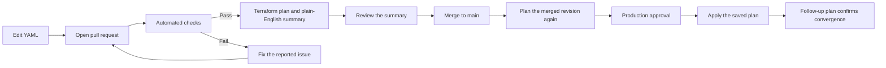

# Start here

*Who this is for: everyone, before anything else.*

This repository controls Cloudflare for our domains: DNS records, the
firewall (WAF), redirects, caching and security settings. Instead of
clicking in the Cloudflare dashboard, you edit small text files and open a
pull request. A computer then shows exactly what would change in
Cloudflare, a colleague checks it, and only then is it applied.

You do **not** need to know Terraform. If you can edit a text file, you
can make changes here.

> **New here?** Start with one small change, such as a DNS record. Find the
> matching YAML file, copy an existing example, and follow [Making a
> change](11-making-a-change.md). You can ask questions in the pull request;
> nothing is applied until the required checks and approvals pass.

## The short version

| Step | What you do | What the repository does |
|---|---|---|
| 1 | Edit the YAML file for the thing you want to change. | Checks the file for syntax and configuration mistakes. |
| 2 | Open a pull request. | Builds a Terraform plan and writes a plain-English summary. |
| 3 | Read the summary and fix anything unexpected. | Shows additions, edits, deletions, warnings, and dashboard changes. |
| 4 | Ask for review and merge only when the summary is correct. | Plans the merged revision again from `main`. |
| 5 | Approve the deployment after the final review. | Applies only the saved plan and checks that Cloudflare converged. |

You normally do not run `apply` yourself. The CI workflow applies shared
domains after the pull request and deployment approvals.

## Choose your next step

| If you are... | Start here |
|---|---|
| Adding or changing a record, rule, or setting | [Making a change](11-making-a-change.md) |
| Reviewing someone else's pull request | [Reviewing a pull request](13-reviewing.md) |
| Seeing a red check or an unexpected plan | [Troubleshooting](36-troubleshooting.md) |
| Seeing a dashboard/API change in the summary | [Deviation detection](14-deviation-detection.md) |
| Setting up the repository or CI | [Setup for maintainers](30-setup.md) |

## Which guide do I need?

| I want to... | Read |
|---|---|
| Change a DNS record, a firewall rule, a redirect or a setting | [10 YAML in five minutes](10-yaml-basics.md), then [11 Making a change](11-making-a-change.md) |
| Understand the change summary on my pull request | [12 Reading the change summary](12-reading-the-change-summary.md) |
| Review someone else's pull request | [13 Reviewing a pull request](13-reviewing.md) |
| Understand a "deviation" issue, or I changed something in the dashboard | [14 Deviation detection](14-deviation-detection.md) |
| Turn a best-practice check on/off or warning/error | [40 Policy](40-policy.md) |
| Write the `##` Owner/Purpose/Impact block above a record | [41 Record documentation](41-record-documentation.md) |
| Look up what a file or field means | [20 Service reference](20-services.md) (full detail); each file's header has a short summary and one example |
| Set the repository up, add a domain, run CI | [30 Setup for maintainers](30-setup.md) and the 3x guides |

## The five rules

1. **Change Cloudflare through this repository, not the dashboard.**
   Dashboard changes are detected as deviations. Safe deviations may be
   committed back into the YAML automatically; unsafe ones become an issue
   for a maintainer to review.
2. **Only edit the `.yaml` files.** Never edit `.tf` files unless you are a
   maintainer.
3. **Every file explains itself.** Read the comments at the top of the file
   you are editing for a quick summary and one example; the full field list
   is in [20 Service reference](20-services.md).
4. **Read the change summary before asking for a review.** It is the exact
   list of what will happen in Cloudflare.
5. **When something looks wrong, stop and ask.** Shared changes need pull
   request review and deployment approval.

## Before you open a pull request

- Confirm that you are editing the correct domain folder.
- Read the header at the top of the YAML file.
- Keep the existing record or rule key when changing an item.
- Run validation if you are working locally.
- Read the complete change summary, including warnings and **Changed outside
  Git**, before requesting review.

If the summary is not what you expected, do not merge. Fix the YAML or ask
for help in the pull request.

## How a change flows

## Where things are

| Location | Purpose |
|---|---|
| `domains/<your-domain>/domain.yaml` | Zone identity and Cloudflare plan |
| `domains/<your-domain>/dns/` | DNS records, DNSSEC, and Email Routing |
| `domains/<your-domain>/waf/` | Custom, rate-limiting, managed, and OWASP rules |
| `domains/<your-domain>/security/` | HSTS, TLS, certificates, access rules, bot protection, and related security controls |
| `domains/<your-domain>/cache/` | Cache rules, variants, and tiered-cache settings |
| `domains/<your-domain>/rules/` | Redirects, rewrites, request/response headers, origin, configuration, and compression rules |
| `domains/<your-domain>/settings/zone.yaml` | Zone-wide SSL, TLS, HTTPS, caching, and speed settings |
| `account/` | Account-wide lists, redirects, WAF, Logpush, notifications, registrar, SSO, and user groups |
| `policy.yaml` | Best-practice checks and their warning/error severity |

Ignore everything else unless you are a maintainer.

## Words you will see

| Word | Meaning |
|---|---|
| **YAML** | The simple text format of the files you edit. See [10](10-yaml-basics.md). |
| **Plan** | A preview of the changes Terraform would make. Creating a plan does not change Cloudflare. |
| **Change summary** | The plan in plain English, posted on your pull request. |
| **Apply** | Making the approved changes in Cloudflare. Only the deployment workflow should do this for shared domains. |
| **Deviation** | Something changed in Cloudflare outside this repository (usually the dashboard). Auto-fixed when it validates cleanly, otherwise flagged for review. |
| **Adopt** | Taking over something that already exists in Cloudflare without changing it. |
| **Zone** | One domain in Cloudflare (example.com). |
| **Proxied** | Orange cloud: traffic goes through Cloudflare's network. |
| **Ruleset / rule** | Firewall, redirect, cache and other rules. Rules in a file run top to bottom. |
| **State** | Terraform's record of what it manages, stored in Cloudflare R2. Do not edit or commit it. |
