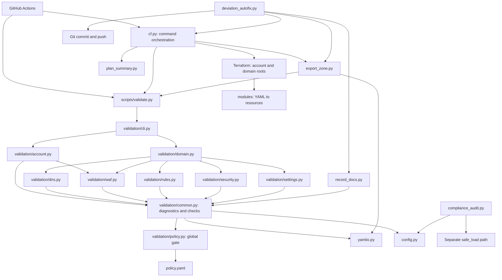

# Script analysis and refactoring plan

Assessment date: 10 October 2026. This assesses the current working tree,
including the existing changes to `scripts/validation/common.py` and the
untracked validator corpus. No production code was changed for this assessment.

## Recommendation

Refactor in small, independently reviewable steps. First establish the
behavior baseline, then fix the demonstrated malformed-input crashes in a
separate change, then split account validation, DNS validation, and export
transformations by responsibility. Keep script entry points and existing
reporting contracts throughout. Refactor deployment orchestration last.

The code already has useful boundaries: service-specific validator modules,
a line-aware YAML loader, a shared diagnostic context, a policy catalog,
export fixtures, and a fake Cloudflare API. Build on these boundaries rather
than replacing everything with a framework.

## Scope and map

Reviewed the Python scripts, `cf.py`, tests, CI call sites, maintainer guides,
and the Terraform boundary used by the scripts. Production Python consists
of 23 files and 5,455 physical lines, including comments, blank lines and
template text. This is a scripts architecture assessment, not a full security
or correctness audit of every Terraform resource.

Graphify outputs:

- [Interactive dependency graph](../graphify-out/graph.html)
- [Expandable source tree](../graphify-out/GRAPH_TREE.html)
- [Architecture report](../graphify-out/GRAPH_REPORT.md)
- [Community navigation](../graphify-out/wiki/index.md)
- [Machine-readable graph](../graphify-out/graph.json)

The final clustered graph has 542 nodes, 1,321 relationships and 23 communities.
The map uses local AST extraction, clustering without LLM community labels,
and wiki/tree exports. Documentation and YAML are not semantically indexed.
Graphify detected 102 code files, but reported that 58 Terraform and seven
HCL files contributed no nodes because `tree_sitter_hcl` is unavailable.
Do not interpret missing graph edges as proof of independence: subprocess
entry points, dynamic imports, and YAML-to-Terraform mappings need source
inspection. Clustering can collapse parallel relationships; consult source
and raw extraction when exact relationship counts matter.



Arrows above include inspected subprocess and configuration dependencies;
this diagram is a curated companion to the automatically extracted graph.
The `common`/`policy` dependency is a runtime dependency through a local
import in `Ctx.flag()`, even though Graphify reports no import cycles.

## Measured hotspots

Function length is the inclusive AST source span. Branch nodes count `if`,
`for`, `while`, `try`, and conditional expressions inside the function;
they are an indicator, not a cyclomatic-complexity measurement.

| File | File lines | Largest relevant function | Function lines | Branch nodes |
|---|---:|---|---:|---:|
| `scripts/export_zone.py` | 823 | `export_account` | 131 | 40 |
| `scripts/gen_template.py` | 696 | Mostly embedded instruction text | — | — |
| `scripts/compliance_audit.py` | 648 | `audit_domain` | 236 | 65 |
| `cf.py` | 616 | `main` | 53 | 1 |
| `scripts/plan_summary.py` | 372 | `summarise` | 64 | 18 |
| `scripts/validation/common.py` | 349 | `check_rule_schema` | 41 | 20 |
| `scripts/validation/dns.py` | 330 | `validate_dns` | 290 | 102 |
| `scripts/deviation_autofix.py` | 286 | `main` | 122 | 19 |
| `scripts/validation/account.py` | 206 | `validate_account` | 91 | 35 |
| `scripts/validation/waf.py` | 165 | `validate_waf` | 132 | 49 |
| `scripts/validation/security.py` | 146 | `validate_security` | 137 | 37 |

File size alone is misleading: the template generator is mainly content;
`cf.py` has many reasonably small functions but mixes several consequential
workflows. DNS, WAF, account validation and audit evaluation are the clearest
function-level extraction opportunities.

## Findings and consequences

### 1. Field checking is not a validity predicate

`common.py:215` returns false when the object is not a mapping, but otherwise
returns true even after reporting unknown fields, missing required fields,
or invalid field types. Many callers assume that a true result permits
`.get()`, iteration, length calculations, or direct indexing.

Changing this helper globally to return false on any error would suppress
additional diagnostics across account, DNS, domain, security and WAF checks.
Keep its existing semantics during extraction. Add explicit local shape
guards for demonstrated crash fixes; consider a more expressive result type
only later, with an explicit diagnostic contract.

### 2. Demonstrated account validation crashes

Reproduced by calling `validate_account(Report(), temporary_directory)` with
minimal files; no Cloudflare requests are involved.

| File content | Observed exception | Cause |
|---|---|---|
| Valid account ID with `plan: invalid` | `KeyError: 'invalid'` | Enum error is reported, then the invalid plan indexes the limit map |
| `lists/ip.yaml`: `my_list: null` | `AttributeError` on `.get()` | `l or {}` is checked but the original null is subsequently used |
| `lists/ip.yaml`: `my_list: {items: 123}` | `TypeError` on `len()` | Field type error does not stop downstream list handling |
| `settings/turnstile.yaml`: `widget: null` | `AttributeError` on `.get()` | Same checked-fallback/original-value mismatch |

These are correctness changes, not merely cleanup. Define the intended
diagnostics and continuation behavior in focused tests before fixing them.
Extend this malformed-shape matrix to DNS, security, WAF and notification
mechanisms; those additional cases have not all been reproduced here.

### 3. Account and DNS functions combine unrelated work

Account validation mixes metadata, four item formats, duplicate detection,
cross-file name tracking, aggregate limits and service orchestration.
Names, counts, and the total item count are shared state. Preserve which
entries contribute to those aggregates, even when an entry is invalid.
The existing total includes redirect items and applies an aggregate check
when other lists exist; review that separately rather than changing it while
extracting helpers.

DNS validation handles ordinary records, SPF, DMARC, DKIM, CAA, SRV, DNSSEC,
Email Routing and cross-file checks. A shared record collection connects
some of these sections. Extract each section with the same inputs and
collection behavior before introducing a new record model.

### 4. Shared infrastructure has excessive responsibilities

`common.py` contains reporting, generic checks, schema loading, documentation
scanning, expression checks and DKIM DER parsing. `record_docs.py` and
`backfill_record_docs.py` import its top-level-key scanner, which also loads
the provider rule schema as an import side effect. A documentation helper
should eventually depend on a small YAML/documentation utility instead.

`policy.py` loads a global `GATE` at import time. `common.py` imports it
lazily while policy imports `ROOT` from common. Tests that run multiple
policy configurations in one interpreter need explicit control over that
state. Introduce injected policy only after tests establish policy behavior.

### 5. Export has good staging boundaries but repeated transformations

`export_zone.py` combines HTTP retries, pagination, transformations, provider
schema filtering, import addresses, disk writes, reports and CLI parsing.
Zone and account WAF/rate-limit transformations are similar but not identical:
for example, zone custom-rule export preserves skip logging and zone
rate-limit export carries additional fields. A shared converter must preserve
these differences deliberately.

Zone export fetches all API data before replacing a destination, which is
worth preserving. Account export writes into the account directory and
validates afterward. Keep publication behavior unchanged during extraction;
introducing staged/atomic account export is a separate improvement.

### 6. Deployment and resync code require stronger contract tests

`cf.py` owns subprocesses, backend setup, saved-plan fingerprints, revision
checks, destructive-change limits, confirmation and root selection. Keep
validation, fingerprint verification, summary and destructive checks ahead
of apply. `plan_input_digests()` already includes every Python script, so
moving implementation files inside `scripts/` remains covered by that hash.

`cmd_deviation_check()` writes `terraform show` stdout without first checking
its return code, unlike `cmd_plan()`. This deserves a separate failure-path
test and fix. `changed_roots()` explicitly detects `modules/`, `scripts/`,
policy and backend changes, but does not explicitly detect `cf.py` or
`requirements.txt`; mixed changes can therefore underselect roots. Treat
this as a source-review finding pending a focused reproduction/test.

`deviation_autofix.py` has a long orchestrator with staged zone export,
documentation preservation, restrictions on newly managed settings, drift
rechecking, then commit/push. Its account path is not staged. It can modify
local files before a later guard fails; extracting it must not accidentally
advance publication or drop a guard. No remediation command was executed
against this repository or live Cloudflare during this assessment.

### 7. Configuration and documentation can drift

`PLANS` and ID patterns are duplicated in `cf.py` and `config.py`.
Rule-file maps and bot-plan subsets appear in validator, exporter and
Terraform with different purposes. Consolidate only truly equivalent data;
export subsets are not automatically the same as all valid configuration.

`docs/37-maintaining.md` refers to `scripts/config/limits.py` and
`scripts/config/bot.py`, while the current implementation is `config.py`.
The destructive-brake message similarly names `scripts/config/thresholds.py`.
Update those references alongside the relevant future change.

### 8. Audit evaluation is a distinct subsystem

`compliance_audit.py` combines control evaluation, evidence strings, live
deviation subprocesses and Word rendering. Its loader converts YAML syntax
errors into `None`, indistinguishable from missing input. The validator uses
duplicate-key detection; the audit uses `safe_load`. Do not unify their
semantics silently. Extract evaluation by area and snapshot the complete
control results before changing invalid-input handling.

### 9. Smaller modules mostly need restraint

`validate.py` is already a compatibility wrapper. Domain orchestration,
settings validation, YAML helpers, record-documentation helpers and schema
generation are reasonably scoped. `plan_summary.py` already separates
comparison from rendering; add output snapshots before further splitting.
`gen_template.py` is mostly text: move content to resource files only if that
improves editing, with byte-for-byte generated-output checks.

## What the existing tests protect

| Area | Existing protection | Remaining gap before significant refactoring |
|---|---|---|
| Validation | CLI scenarios, policy tests, diagnostic corpus and golden file | Invalid nested shapes; explicit output order; all helper outcomes |
| Diagnostic corpus | Trace-based diagnostic-site reachability and sorted full tuples | Not branch coverage; not all malformed inputs; scanner only visits immediate `validation/*.py` |
| Export | Fixture-backed zone/account export, overwrite refusal, permission failure | Retry/pagination failures and broader account WAF field fidelity |
| Plan reporting | Adds, deletes, replacements, drift, noise filtering, rule movement | Exact text/Markdown snapshots and malformed plan contracts |
| Destructive brake | Boundary, replacement counts, override, summary warning | Full apply sequencing and fingerprint/revision failures |
| Resync | No deletions, documentation retention, managed settings, live drift changes | Account staging/failure behavior and partial filesystem mutation |
| Compliance audit | Four focused correctness checks | Full result catalog/status/evidence snapshots; malformed YAML |
| Template/schema tools | Indirect consumers and validation | Data-preserving refresh and generated-output equivalence |
| Full workflow | Mocked Terraform tests and fake-API E2E in CI | Must rerun after changes to import addresses or orchestration |

The corpus deliberately sorts diagnostics, preserving duplicate multiplicity
but allowing order changes. Its exclusion `('cli.py', 51)` is tied to a source
line, and its scanner matches particular variable names. Preserve this gate,
but make it recursive and replace the brittle exclusion before introducing
validator subpackages. Do not regenerate the golden file merely to make a
structural refactor pass.

## Variable naming standards

Treat naming as an acceptance criterion in every refactoring step. Use
`snake_case` for variables and functions, `PascalCase` for classes, and
`UPPER_SNAKE_CASE` for module constants. Names should express the domain role,
not just the Python type. Keep familiar domain abbreviations such as DNS,
WAF, ASN, TTL and CSR; avoid ambiguous abbreviations and single-letter names
in business logic. Short indices can remain in tiny, obvious loops.

Concrete account-validation examples:

| Current name | Proposed name | Meaning |
|---|---|---|
| `a` | `account_dir` | Account configuration directory |
| `f` | `config_file` | YAML file being validated |
| `lines` | `line_numbers` | YAML path-to-line-number mapping |
| `kind` | `list_kind` | IP, ASN, hostname or redirect list kind |
| `lname` | `list_name` | User-defined list identifier |
| `l` | `list_config` | Configuration for one named list |
| `p` | `list_path` | Diagnostic path tuple, not a filesystem path |
| `it` | `item` | One list item |
| `ip_` | `item_path` | Diagnostic path tuple; it is not an IP address |
| `v` | `ip_value`, `asn_value`, `hostname` or `source_url` | Value specific to an extracted item validator |
| `names` | `list_source_files` | Mapping from list name to its source filename |
| `total` | `total_item_count` | Aggregate item count |
| `counts` | `list_counts` | Number of lists in each limit category |
| `seen` | `seen_item_values` | Values used for duplicate detection |
| `max_lists` | `custom_list_limit` | Plan limit for non-redirect lists |

Apply the same distinctions elsewhere: `domain_dir` instead of `d`,
`zone_id` instead of `zid`, `action_parameters` instead of `ap`,
`resource_change` instead of `rc` in plan processing, and `exit_code` for a
process return code. Use `cli_args` for parsed command-line arguments and
`process_result` for a subprocess result. Distinguish filesystem paths
(`config_file`, `staging_dir`) from diagnostic paths (`field_path`,
`item_path`). Reserve names such as `is_enabled` or `has_changes` for actual
boolean predicates; do not rename a raw YAML value as if its type were
already validated.

Rename locals as their function is extracted, without combining the rename
with changes to coercion, defaults, duplicate identity or counting. Avoid
reusing one name for unrelated values or shadowing built-ins such as `list`,
`dict`, `id` and `type`; use `record_type`, `resource_id` or `list_config`.
New helpers should use descriptive parameter names from the start.

Existing parameter names and object attributes may be used by keyword
callers, tests or other scripts. Check those callers before renaming and
retain compatibility where needed. YAML keys, CLI flags, Terraform addresses
and diagnostic text are external contracts, not targets of variable cleanup.
The diagnostic corpus also recognizes receiver names `ctx` and `report`;
keep those established names unless its scanner is updated in the same
change, so a rename cannot silently reduce coverage.

## Phased implementation plan

1. **Baseline and missing contracts.** Preserve the current changes; establish
   passing unit tests and validator golden output. Add focused tests for the
   demonstrated crashes, apply/fingerprint failure paths, CLI exit codes and
   exact representative report output. Decide explicitly whether CLI diagnostic
   order is part of the contract; preserve it by default. Expand corpus discovery
   before moving diagnostics into subdirectories.
2. **Separate bug-fix change.** Guard invalid plans, null entries and incorrectly
   typed list values locally. Keep `check_fields()` semantics. Define whether
   subsequent independent files continue to validate; ensure errors produce
   diagnostics and exit code 1 rather than a traceback. Fix the deviation-show
   failure and root-selection issue in their own tested changes.
3. **Account extraction first.** Keep `validate_account(report, a)` as the public
   function. Extract metadata validation, list iteration/aggregation, individual
   IP/ASN/hostname/redirect item checks, and plan-limit checks. Keep the existing
   service validators and return value `set(names)`. Start with private helpers
   in `account.py`; introduce another file only if it gives a useful boundary.
4. **DNS extraction.** Keep `validate_dns(report, d, plan, zone)`. Extract base
   records, SPF, DMARC, DKIM, CAA, SRV, DNSSEC, Email Routing and cross-file checks,
   preserving shared record accumulation and diagnostic order. Apply the same
   method to WAF and security after DNS proves the approach.
5. **Shared infrastructure.** Move reporting, pure field checks, documentation
   scanning, provider schema loading and DKIM parsing to suitable small modules.
   Keep compatibility exports from `common.py` initially. Inject policy explicitly
   only after callers and tests can express the desired gate without global state.
6. **Export boundaries.** Extract the HTTP client, pure record/rule converters,
   import-address construction and output writing. Preserve `Client`, `ZoneExport`,
   `export_zone()` and `export_account()` imports through the original module.
   Compare semantic YAML, import addresses and preserved documentation against
   fixtures. Test account/zone differences before sharing a converter.
7. **Reporting and audit.** Snapshot summary text/Markdown; split only where
   needed. Split audit evaluation by control area and Word rendering from the
   evaluators. Preserve control IDs, status, scope, severity and evidence.
8. **CLI and resync last.** Retain `cf.py` and all script paths as thin entry points.
   Move backend handling, plan integrity and command execution behind explicit
   interfaces. Extract resync stages without reordering guards. Run the complete
   fake-API workflow before considering staged account publication separately.

Each step should be one small change or a series of small PRs. Avoid combining
new dependencies, formatting the whole repository, behavior changes, and file
moves. Prefer descriptive helper names and explicit inputs over an elaborate
validator inheritance hierarchy or an all-purpose dispatch framework.
Apply the naming standards above within each step, with consistent vocabulary
across validators, exporters and tests. Review remaining ambiguous names
before considering a step complete.

## Acceptance checks

For each implementation change:

```powershell
.\.venv\Scripts\python.exe -m unittest discover -s tests -v
.\.venv\Scripts\python.exe scripts\validate.py --all
```

For validator changes, require the unchanged diagnostic golden file and
diagnostic-site gate, plus focused tests for any intentional new behavior.
For export, CLI, resource-address or shared configuration changes, also run:

```powershell
.\.venv\Scripts\python.exe cf.py test-all
.\.venv\Scripts\python.exe tests\e2e\run.py
terraform fmt -recursive -check
```

These are future implementation gates, not claims that Terraform/E2E checks
ran for this documentation-only assessment. Use fixture data and the local
fake API; live apply is not needed to validate structural extraction.

After production-code changes, run `graphify update .` as required by
`AGENTS.md`, then refresh wiki/tree outputs if needed. To complete Terraform
coverage, install Graphify's Terraform parser in its tool environment and
re-extract; the present graph's parser limitation remains explicit.

No finite test suite can guarantee that nothing will break. The practical
standard is preserved contracts, small diffs, meaningful failure-path tests,
and the full offline workflow passing before a refactor merges.

## Assessment baseline result

The repository virtual environment ran `python -m unittest discover -s tests -v`:
**84 tests passed in 283.769 seconds**, including all three validator-corpus
tests (diagnostic production, diagnostic-site coverage, and golden output).
The four crash probes are deliberately outside that suite and expose gaps
despite the passing baseline. Terraform plan tests and fake-API E2E were not
run for this documentation-only assessment.

## Implementation progress: account validation

The first implementation increment is complete:

- `validate_account()` is a 16-line orchestrator. Private helpers separate
  metadata, list aggregation, each item format and plan limits.
- Account validators use descriptive local names for directories, files,
  diagnostic paths, item values and aggregate counts. Existing public
  parameter names remain compatible with keyword callers.
- The four reproduced crashes are fixed. Invalid account plans report an
  error and use the existing Enterprise fallback for subsequent checks;
  the error still blocks deployment. Null list/widget entries retain their
  missing-field diagnostics. Invalid item containers are not iterated.
- Five focused regression tests cover the failures, continuation after an
  error, duplicate identity across scalar/mapping items and line reporting.
- **89 unit tests pass (231.450 seconds)**. Repository-wide YAML validation
  passes with one existing DMARC warning. `git diff --check` passes.
- All **218 corpus diagnostics**, including discovery order, match the
  original account implementation from Git. The missing golden file was
  restored from that original baseline after the comparison succeeded.
- Graphify was updated and its report, wiki and interactive tree refreshed.

This increment does not complete the DNS, exporter, audit or CLI phases.
The Terraform parser limitation remains. Terraform plan/E2E tests were not
run for this account-validator change; no resource addresses or deployment
orchestration were modified. Existing changes to `.gitignore`, `common.py`
and the diagnostic corpus were preserved.

## Implementation progress: DNS validation

The DNS extraction keeps `validate_dns(report, d, plan, zone)` as the public
entry point. Its 290-line body is now a 12-line orchestrator. Private helpers
separate ordinary-record collection, one-record checks, FQDN normalization,
SPF, DMARC, DKIM, CAA, SRV, DNSSEC, Email Routing and cross-file checks.
The largest helper is 50 lines. File-shape guards reduce nesting without
changing the sequence of diagnostics.

Local variables now describe their roles: `record_type`, `record_key`,
`record_path`, `config_file`, `line_numbers`, `spf_config`, `dmarc_config`,
`dkim_config`, `lookup_count` and `seen_rule_refs`. Existing public parameter
names and TXT helper interfaces remain compatible.

Three new tests protect the cross-file SPF record collection, apex CNAME
coexistence, quoted/plain TXT duplicate identity, line reporting and error
discovery order. The original DNS implementation from Git and the refactored
implementation produce the same **218 corpus diagnostics in the same order**.
The existing golden file is unchanged; all diagnostic sites remain covered.
This phase introduces no intentional validation behavior changes or new
malformed-input fixes.

**92 unit tests pass (643.337 seconds)**, including the diagnostic-site and
golden-snapshot gates. Repository YAML validation and `git diff --check` pass.
Graphify's graph, report, wiki and interactive tree were refreshed. Terraform plan/E2E tests
were not run for this validator-only extraction. WAF and security validation
are the next extraction targets.

## Implementation progress: WAF and security validation

WAF now separates custom rules, rate limits and managed rulesets into file
validators, with individual custom-rule and rate-limit helpers. Security
now dispatches to ten file validators and a separate IP-access-rule helper.
Early returns reduce file-shape nesting while retaining the existing
`check_fields` behavior and diagnostic sequence. Public entry points and
keyword parameter names remain compatible.

Local names describe the configuration and its role: `configuration_dir`,
`file_path`, `field_types`, `skip_settings`, `characteristics`,
`unsupported_characteristics`, `cloudflare_managed`, `score_threshold`,
`setting_name`, `supported_plans`, `value_validator` and `rules_by_target`.
Shared WAF reference state is still passed through all three file validators
and through the account and domain entry points.

All **218 corpus diagnostics match the original implementations from Git**,
including discovery order, YAML locations, messages and hints. All diagnostic
sites remain covered and the golden file is unchanged. Repository YAML
validation passes with the existing DMARC warning. No intentional behavior
changes or malformed-input fixes are included in this extraction.

Graphify's graph, report, wiki and interactive tree were refreshed
(793 nodes, 1,802 edges, 43 communities). The Terraform parser limitation
remains; Terraform plan/E2E checks are outside this validator-only increment.
The next phase is shared validation infrastructure, followed by exporters,
audits and CLI orchestration as described above.

**92 unit tests pass (248.179 seconds)** on the corrected implementation;
`git diff --check` also passes. The largest extracted helper is 41 lines.

## Implementation progress: remaining phases

The remaining structural phases are implemented. Existing entry points and
public keyword parameters remain compatible; `common.py` remains an import
facade and retains YAML loading. Smaller validators, schema/template tools
and the already separated plan-summary evaluator/renderer were kept scoped
as recommended above. Template text and generated Terraform addresses were
not rewritten.

### Shared validation infrastructure

- `reporting.py`: Report/Ctx and console/Actions rendering. Ctx accepts an
  optional injected policy gate; existing callers keep the global default.
- `checks.py`: type, field, enum, reference, expression and network checks.
- `record_documentation.py`: documentation-block scanning, imported directly
  by record-documentation tools without loading the provider schema.
- `dkim.py`: tag/DER parsing and RSA key sizing.
- `schema.py`: provider schema loading and recursive schema validation.
- `paths.py`: repository root independent of reporting and policy imports;
  policy now imports this module, removing the previous common/policy cycle.

All modules remain immediately under `validation/`, so the existing corpus
scanner sees the moved diagnostic sites. Its golden file was kept unchanged.
The existing `check_fields()` mapping predicate and continuation behavior
are preserved. Existing user changes in common were moved intact.

### Export boundaries

`export_client.py` owns read-only requests, retry delays and pagination;
`export_converters.py` owns pure DNS/list/rule field conversion;
`export_services.py` collects a zone export in memory; `export_output.py`
writes import blocks and prepares backed-up destinations; `export_config.py`
contains export-specific endpoint/field maps. `export_zone.py` preserves
Client, ZoneExport, converter and publication imports and the CLI.
Account collection is separated into lists, WAF and Logpush stages.

Account and zone custom/rate-limit conversion is shared with explicit
options preserving the original differences: skip logging and additional
rate-limit/response fields remain zone-only. Focused tests cover these
differences, HTTP retry exhaustion, Retry-After, permission/404 failures and
pagination. Complete fixture snapshots protect YAML, import addresses,
notes and counts. All API reads still precede zone destination replacement;
account publication remains in place as before.

### Reporting and audit

Domain evaluation is separated into DNS, TLS, WAF, rate limiting, bots,
cache, origin and logging helpers. Account evaluation is separated into
lists, WAF, logging, notifications, repository controls and ownership.
`audit_report.py` handles Word rendering and `audit_catalog.py` holds the
status palette and unevaluated-control catalog. Audit entry points and
Result attributes remain compatible; malformed-YAML handling is unchanged.

Full result snapshots cover all four plans, an empty domain and account
controls. Word document/settings/core-metadata XML matches the original
renderer, with a fixed report date in tests. Representative plan-summary
text and Markdown are snapshotted; its existing separation was retained.

### CLI and resync

`workflow_backend.py`, `workflow_integrity.py`, `workflow_process.py` and
`workflow_parser.py` expose backend setup, plan input hashing, subprocess
execution and argument definitions. cf.py keeps guarded command sequencing
and compatibility functions; its main is a seven-line dispatcher.
`deviation_autofix.py` separates argument parsing, initial drift capture,
account/domain export, export invariants and commit/push stages.
The guard sequence is unchanged: preserve docs, reject deletions, validate,
check status, recheck live drift, then publish. Only fake-API/test publication
was executed; no live Cloudflare apply or real repository push was run.

Two reviewed workflow correctness issues were fixed with regression tests:
failed Terraform show stops before writing a deviation report or running
its summary, and cf.py/requirements/backend changes select all roots even
when a domain file also changed. Apply tests require validation, fingerprint,
summary and destructive checks before Terraform. Saved plans are refused
when scripts, backend or revision change or safety markers are missing.
All 18 command help/flag outputs match the original and are snapshotted.
Maintainer references now name scripts/config.py and the service exporter.

| Entry point | Before | After (inclusive AST lines) |
|---|---:|---:|
| export_account | 131 | 37 |
| audit_domain | 236 | 22 |
| audit_account | 95 | 15 |
| deviation_autofix.main | 122 | 9 (37-line workflow) |
| cf.main | 53 | 7 |

Naming now follows role-specific vocabulary in touched code: cli_args,
process_result, exit_code, api_rule, action_parameters, record_config,
account_list, converted_items, initial_drift and existing_documentation.
Legacy public parameters and object attributes remain available.

### Completion gates

Terraform format checking passes. Mocked Terraform tests pass for account,
example.com and example.net. The fake-Cloudflare E2E workflow passes through
creation, clean re-plan, dashboard drift, stable drift fingerprints, PR
changes, cancellation, apply and clean final re-plan. Registry access for
provider initialization required execution outside the network sandbox.
Repository YAML validation passes with the existing example.net DMARC warning.

Further behavior changes (atomic account publication, broader malformed-input
handling, new live audit controls) remain separate future work. The Graphify
Terraform parser limitation is unchanged; it does not block the Python
architecture map or the real mocked Terraform/E2E checks above.

Final completion checks: **111 unit tests pass (117.603 seconds)**; all
**218 diagnostics** retain their original values and discovery order after
the shared-helper split. `git diff --check` passes. The validation golden
file was not regenerated. Final Graphify extraction contains 918 nodes,
2,080 relationships and 45 communities.

## Package organization

Implementation modules now follow these responsibility boundaries:

```text
scripts/
  export_zone.py             stable export entry point and compatibility imports
  compliance_audit.py        stable audit entry point/import alias
  deviation_autofix.py       stable resync entry point/import alias
  repository_paths.py       shared checkout/copy discovery
  exporting/
    client.py config.py converters.py services.py output.py publish.py
  audit/
    common.py domain.py account.py catalog.py report.py cli.py
  workflow/
    backend.py integrity.py parser.py process.py resync.py
  validation/               existing flat validator package
  data/                     provider schema
```

Each new package has an `__init__.py`; internal imports are relative and
callers use package names. Redundant export/audit/workflow filename prefixes
were removed. The old flat implementation modules have moved; documented
script entry points, cf.py commands, Client/ZoneExport and export function
imports remain available through the established facades.

Repository discovery starts from the caller's source file and finds the
nearest directory containing cf.py and scripts/. It works for nested modules
and temporary repository copies even when the helper is cached from another
checkout. Export publication receives its root, template and validator
explicitly from the legacy facade, preserving temporary-copy and patched-root
behavior. Audit account evaluation also accepts an explicit repository root.

Imported audit/resync facades point to their implementation module so existing
patches through legacy names affect the same functions and globals. Direct
script execution still invokes the existing CLI. Validator files remain flat,
so this migration requires no diagnostic-site scanner changes or golden
regeneration. Nested implementation files remain included in saved-plan
fingerprints through the existing recursive Python-file collection.

Three additional tests cover distinct checkout/copy resolution, nested-module
fingerprint changes and legacy module identity. Existing resync guard tests,
export fixtures, audit/Word snapshots and CLI snapshots are retained. The
maintainer layout guide has been updated to the new paths.

Package migration validation: **114 unit tests pass (150.469 seconds)**,
including the unchanged 218-diagnostic golden file and coverage gate. Mocked
Terraform tests pass for all three roots; fake-API E2E, Terraform formatting
and `git diff --check` pass. No live deployment or repository push was run.

## Follow-up project review fixes

The nine findings in [the project review](43-project-review.md) have been
implemented with targeted behavior tests: declared CI dependencies, saved-plan
artifact consistency, blocking Terraform YAML validation, Email Routing
lifecycle handling, faithful exports and empty-service handling, nested input
robustness, confined paths, and staged resync with rollback. The existing
review and this plan remain available as the history of the work.

Final verification: **130 tests pass in a clean Python 3.12 environment**,
all three root mock plans and five Email Routing lifecycle tests pass,
and fake-API E2E includes direct Terraform rejection of malformed/wrong-shaped
YAML. YAML, formatting and whitespace checks pass. Graphify was refreshed;
the review document records implementation details and remaining optional
tooling work. No live deployment or project-repository push was performed.
